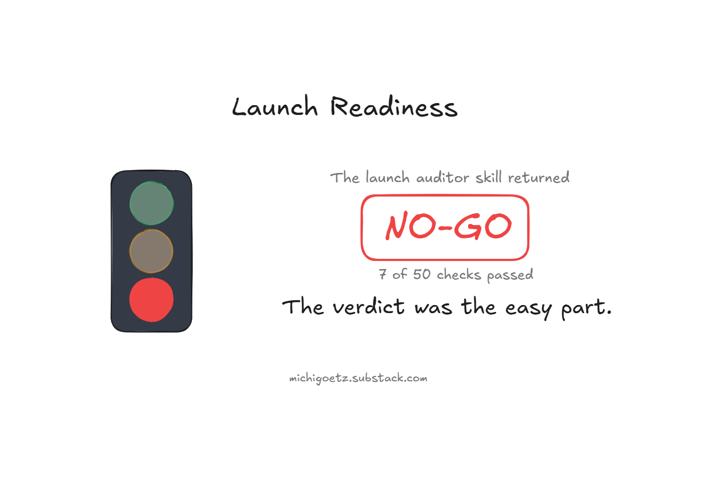
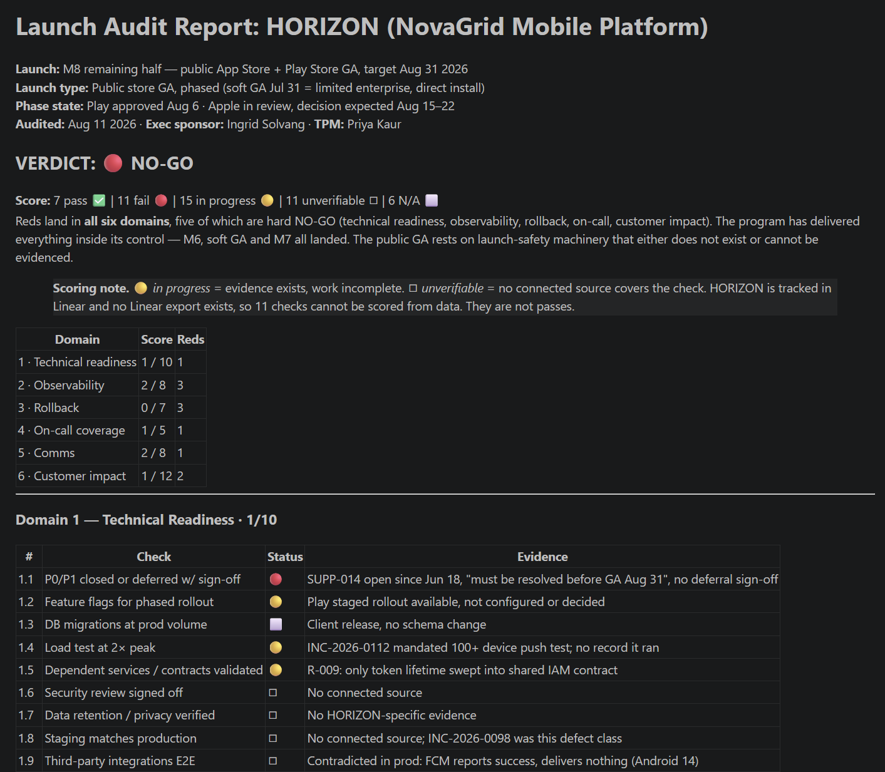
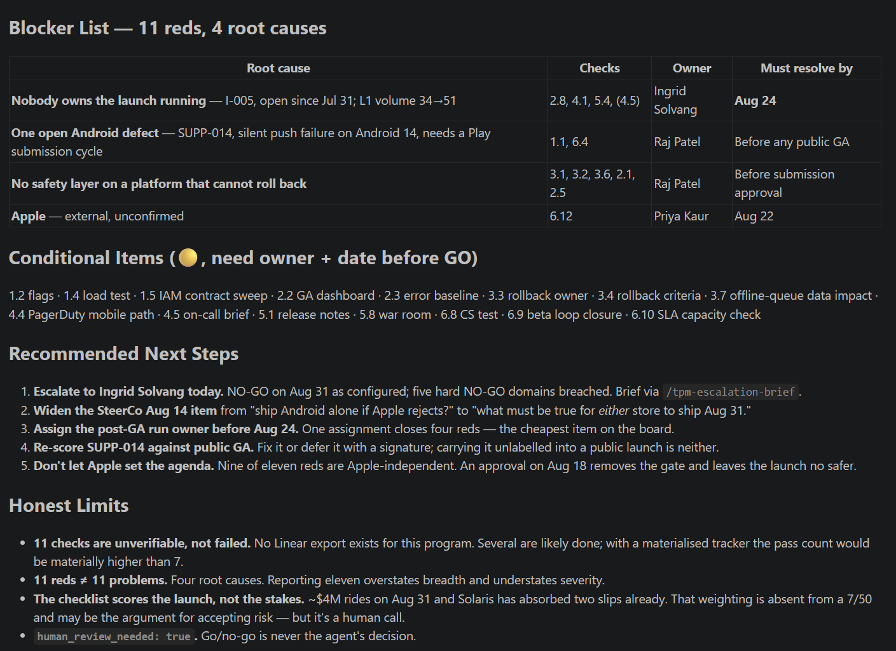

# The Launch Auditor Agent said NO-GO. Here is the meeting that followed.

**2026.AI.17** | *A 50-point launch readiness agent returned NO-GO on a launch the business had already half-shipped. The receipt is the verdict. The story is the meeting after.*

*Michi Goetz - August 2026*

---

🌑☀️[Solar Eclipse Day](https://en.wikipedia.org/wiki/Solar_eclipse_of_August_12,_2026) :) Today the sky runs its own launch review. Over Greenland, Iceland and Spain, the moon slides in front of the sun on a schedule set centuries ago, predicted to the second, impossible to argue with. That is what total certainty looks like: a verdict computed from data that turns out exactly right. The gap between the sky's confidence and the launch auditor’s evaluation is today’s article!

Assuming you have a launch on Friday (deploying on a Friday - why not?). The business has told the customer and the date is in a deck the VP already presented. And the work is by every soft signal, “basically there”.

You run the launch readiness pass anyway and leverage an agent that comes back with: **NO-GO!**

Now what? That is the whole article. Not whether an agent can score a launch checklist (disclaimer: it can), but what a Technical Program Manager, Product Manager or Engineering Manager does in the 90 minutes after the machine says the thing everyone in the room was hoping no one would say.

**Don't want to start from a blank page?**

The 15-check starter, the paste-ready prompt, and the full 50-point launch-auditor skill are bundled in the free **TPM Launch-Readiness Starter Kit**.

[Grab it here](https://michigoetz.substack.com/perks/8fa0b196-14d5-44d0-8cbb-763e998fe445)

### But an agent can’t make a launch call

Correct. It can’t, and it shouldn’t. A launch decision weighs customer commitments, revenue timing, competitive windows, and the political cost of slipping; none of which live in any file the agent reads.

What the agent can do is remove the excuse of not knowing. The NO-GO is not the decision. It is the end of “I think we’re fine” and the start of “here is exactly what is not fine, and who owns each piece.” The decision stays human. The agent just makes sure the human decides against the real state, not the hoped-for one.

That distinction - detection is the agent’s job, the judgement is yours - is the same line the whole [Practical AI series](https://michigoetz.substack.com/t/practical-ai) draws. This is what it looks like under launch pressure.

[Check it out: TPM AI Playbook](https://github.com/michigoetz/tpm-use-cases)

### The setup

Let us go back to our fictional sandbox behind the TPM AI Playbook called Novagrid. NovaGrid’s HORIZON program: a mobile platform, iOS and Android, carrying $4M of contracted and pipeline revenue between two enterprise accounts. Everything below is a real /tpm-launch-auditor run against that state, on its simulated clock. Library link at the end.

The interesting part is that this launch is already half-shipped. A decision earlier in the year split GA into two: a soft GA on July 31 - limited enterprise release, direct install, no store review - and a public App Store GA on August 31. The soft GA landed on its promised date. Both store submissions went in on August 1, on time. Google Play approved on August 6.

So the program has done everything inside its control. What remains is the public App Store GA, and by the week of August 11 the whole team is watching one thing: Apple’s review decision, expected somewhere between August 15 and 22.

That is the launch I pointed the auditor at.

It scores 50 checks across six domains - technical readiness, observability, rollback, on-call coverage, comms, and customer impact. The **NO-GO rule is strict**: any red in the first four domains, or in customer impact, and the launch does not ship.

Seven out of fifty, on a program that has hit every milestone it controls. That number needs explaining before it means anything, and explaining it is the first thing the machine cannot do for you.

### Read the failures, not the score

**Separate “failed” from “couldn’t be checked.”** Eleven of those fifty checks came back unverifiable, not failed. HORIZON is tracked in Linear, and this sandbox has no Linear export. So security review, staging parity, privacy verification, on-call runbooks, comms artefacts, user docs and accessibility have no data source behind them at all. Some are almost certainly done. I scored them as unverifiable rather than quietly promoting them to passes, because a pass you cannot evidence is the exact failure mode a launch checklist exists to prevent. On a program with a materialised tracker, several of those become passes - the count could sit closer to 15 or 18 than to 7.

**Collapse the reds.** Eleven reds is not eleven problems. They collapse to four:

1. **Nobody owns the launch running:** Post-GA support has had no named owner since the soft GA on July 31. That single gap produces three separate reds - no post-launch monitoring plan, no on-call rotation, no support briefing - and holds a fourth check open behind them, because the on-call briefing cannot close until there is a rotation to brief. Mobile support volume has already risen from 34 tickets to 51 since soft GA.
2. **One open Android defect:** More on this below. It is the sharpest item on the board.
3. **No launch-safety layer on a platform that cannot roll back:** No documented rollback path, none tested, no client kill switch, no mobile SLO, and no proof the alerts work. Five reds, one root.
4. **Apple/iOS Store:** The external gate everyone is already watching.

Reporting eleven overstates the breadth and understates the severity. Four is the number you walk into the room with.

**Notice what the score is not telling you.** $4M rides on August 31, and one of those two customers has already absorbed two slipped dates. That weighting appears nowhere in a 7/50. It may well be the argument for shipping with accepted risk rather than closing every gap but it has to be made by a person, out loud, on the record.

### The thing the auditor found that nobody in the room had

Every human artefact in this program, the risk log, the weekly file, the SteerCo agenda, frames the same fallback: *Android is already approved and could ship alone if Apple rejects.* It reads as free. The build is through review. The option costs nothing.

The launch auditor skill scored the Android build and found an open ticket from June 18. On Android 14, the app never requests the runtime notification permission, so push notifications silently fail. Not “fail with an error” - the delivery API reports success and the notification never appears. The ticket’s own notes say a Play Store submission update is required, and that it must be resolved before the August 31 GA.

It has been sitting at P3 since June, and the reason is entirely defensible: at the time it was written, the launch was a limited release to two customers with a manual workaround. P3 was the right call for that launch. It is not the right call for this one.

So the fallback is less ready than the thing it is a fallback for. And the customer whose operations team depends on those push notifications is the same customer who reported the bug, and the same customer whose $2.4M renewal closes two weeks after the GA date.

That is the whole case for running the pass. Not the verdict but the connection. Two facts sat in two different systems, each individually known, and nobody had put them next to each other. The agent did that in one run, and it turns “ship Android alone” from a free option into a decision with a review cycle attached.

### The meeting after

Here is the ninety minutes the agent set up but could not run.

**Reframe the question on the agenda.** The SteerCo item as written is *“ship Android alone if Apple rejects?”* That question assumes Apple is the variable. Only one of the eleven reds has anything to do with Apple. An approval on August 18 removes that single external gate and leaves the launch no safer than it was on August 11. The question is not what Apple decides. It is what has to be true for either store to ship on the 31st.

**Name an owner and a clock for each of the four.** Not a status. A person and a time.

- **The Android defect**: Mobile Eng Lead - fix starts now, not after Apple answers. A Play submission update carries its own review cycle, so this is the item that determines whether the fallback is real. Fixing the bug and deciding the contingency are one decision, not two.
- **The run owner**: the exec sponsor, by August 24. This is the cheapest red on the board: one assignment closes four checks. It has been open since July 31.
- **The safety layer**: Mobile Eng Lead, before submission approval. A mobile SLO with a burn alert, and a kill switch for the client features. You cannot roll back a store build. The only rollback a mobile launch has is a forward fix, and nobody has written down what that path is.
- **Apple/iOS Store:** The TPM, by August 22. Not an action. A watch item with a decision date attached, which is what it should have been from the start.

**Give the business a decision, not a slip.** The wrong move is walking in with “the agent said no.” The soft GA is already live and the contracted commitment for July 31 was already met on the day it was promised - that is not at risk and should be said first. What is at risk is a public store launch with no way to turn a feature off, no one watching it, and a known silent failure on one of the two platforms. Ship the fix, name the owner, arm the alert, and August 31 is a decision the room can make on its merits. Skip them and August 31 is a decision the room is making blind, in front of a customer who has already been slipped twice.

The NO-GO didn’t stop the launch. It changed who was accountable for shipping with a known gap, from “nobody noticed” to “we decided, on purpose, in writing.”

### What the launch auditor cannot see

Three honest limits.

**It scores the checklist, not the stakes.** A failed check on a $4M launch and a failed check on an internal tool read identically to the agent. The consequence weighting is entirely yours.

**It can only see the systems you gave it.** Eleven of fifty checks came back unverifiable for one reason: this program’s execution data lives in a tracker that was never connected. The agent did not know whether the security review happened. It knew that nothing it could read said so. That is the correct answer and it is a useless one, and the fix is not a better prompt - it is a data layer. Every gap in your connectors becomes a gap in your verdict, and the verdict will not tell you which gaps are real and which are just dark.

**A green auditor is not permission.** 50/50 means the documented checks pass. It does not mean the launch is safe - only that the known risks are closed. The unknown ones are still the job, and the honest limits section of every one of these runs is where trust is earned or lost.

### The IC entry point

You do not need a 50-point agent. You need to stop discovering launch gaps in the launch meeting.

1. **Write your launch checklist as a file**: the 10-15 checks you actually care about, in the categories that have burned you before.
2. **Run it as a prompt against your real program inputs:** three days before the date, not the morning of. Keep it read-only to start - it needs to read your Jira, Datadog and docs, not change them - and treat anything it reads as able to steer the output, so you verify before you act.
3. **Make it say “unverifiable” out loud:** The checks it cannot evidence are more useful than the ones it passes - they are a map of where you are flying blind.
4. **Bring options, never a verdict**: the agent’s output is your pre-read, not your announcement.

The Monday action: write down the last launch gap that surprised you, and add it as check #1. The auditor you build is just your own scar tissue, made repeatable.

### What’s next

Summer and PTO time is here. Have you done your vacation test?

Next week will be about an observation and collection from the last months - “TPM is dead”, “Product Management is dead”, and “Software Engineering is dead” and incorporate a collection of LinkedIn posts that claim it and what the pattern behind is.

[Check it out: TPM AI Playbook](https://github.com/michigoetz/tpm-use-cases)

Let’s build

Michi

---

*Originally published on [TPM Breakdowns](https://michigoetz.substack.com/p/launch-auditor-agent-skill-no-go), Aug 12, 2026.*
