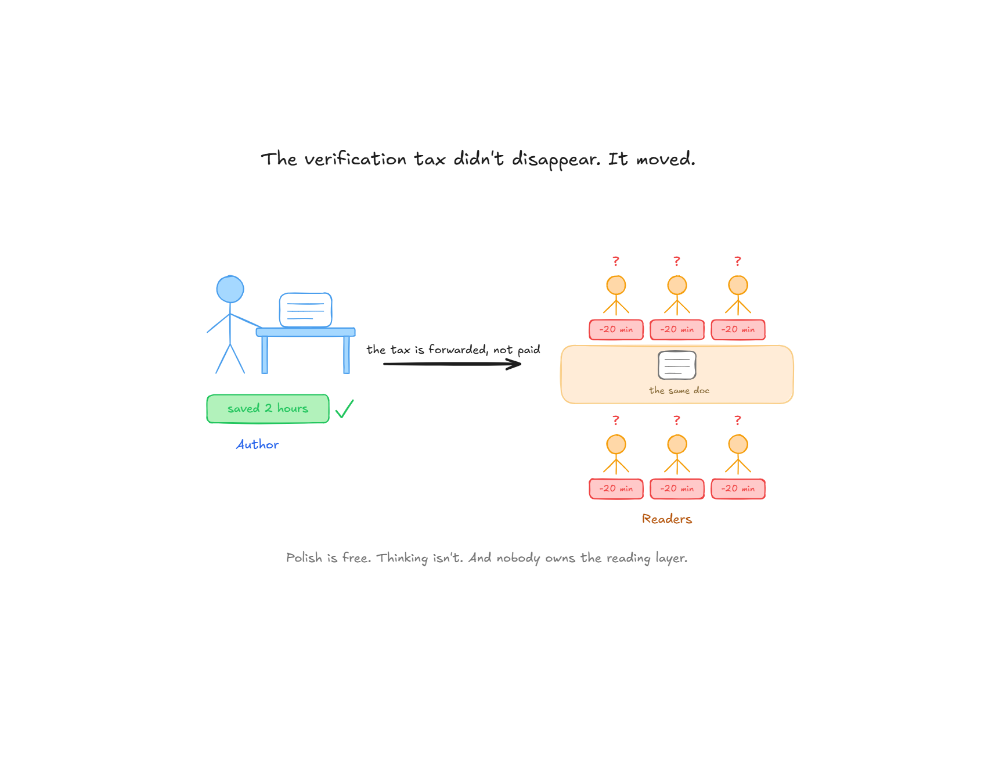
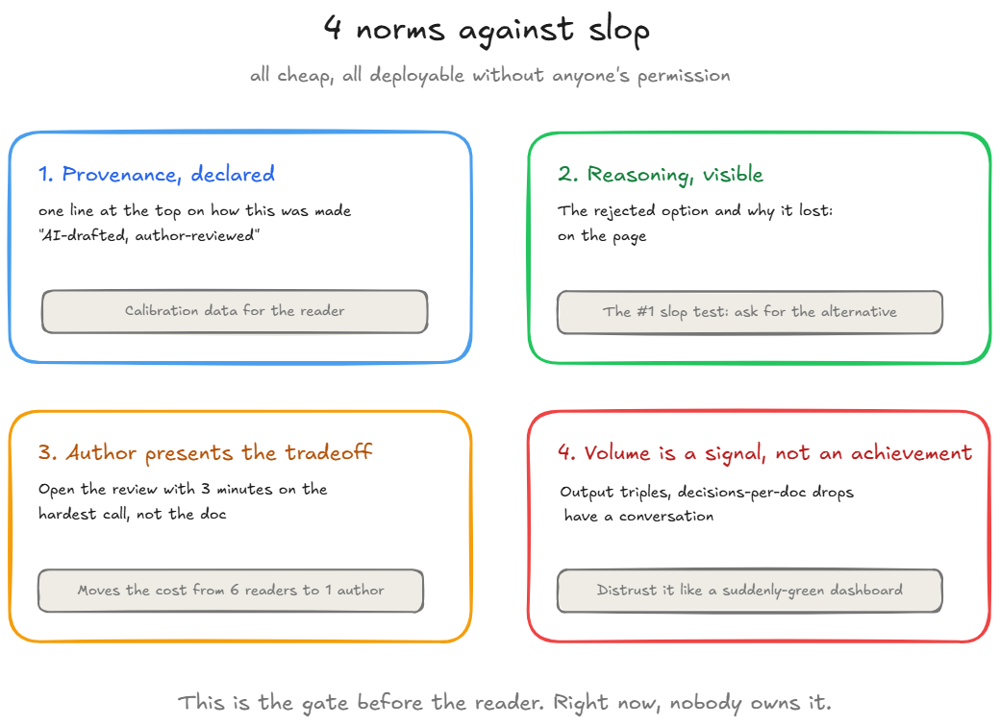

# 📚AI Slop as program risk: The document was perfect. That's the problem.

**2026.AI.19** | *AI slop is a program risk nobody owns: the verification burden didn't disappear, it moved to your readers and the reading layer has no owner.*

*Michi Goetz - September 2026*

---

Tuesday morning. A nine-page technical spec lands in your inbox, two days ahead of the review.

It’s immaculate. Clean structure, consistent terminology, an executive summary that summarizes, a risk section with a table. It reads like the author spent a week on it. You know they had two days.

Thursday, in the review, an engineer asks one question: “You chose polling over webhooks here - what was the failure mode you were worried about?” Silence. The author scrolls their own document, looking for their own reasoning. It isn’t there, because it never happened. The document is complete. The thinking is absent and every engineer in the room just recalibrated how much attention this author’s next document deserves.

**That recalibration is the real cost, and it doesn’t appear in any AI productivity metric.**

The S[tate of AI for TPMs survey](https://aifortpms.substack.com/p/state-of-ai-for-tpms-2026?r=182lh1&utm_campaign=post-expanded-share&utm_medium=web) (n=252) was overwhelmingly positive - 70% saving 2+ hours a week, only 6% reporting any quality decrease. But the open-text responses carried a dissent worth more than its word count. One respondent asked whether anyone else was seeing “a high rise in AI slop documents” in their daily work - documents they’d had to rewrite with colleagues - and named the damage precisely: “a complete loss of authority and respect for the authors from their colleagues.”

*Nobody has named this as a program risk. So let’s name it.*

### **The economics moved, and the burden moved along**

Here’s the mechanism, and it’s not complicated.

Writing a competent-looking document used to cost days. That cost was a filter. If someone shipped nine polished pages, it signaled nine pages’ worth of thinking, because there was no other way to produce them. Readers could allocate attention on that signal, and mostly be right.

AI dropped the production cost to near zero. The filter is gone. The volume of polished documents goes up because polish is now free and volume is now costless to the writer. **Every hour the writer didn’t spend thinking becomes an hour the readers spend discovering that.** Multiplied by every reader in the review.

The survey’s verification-tax numbers describe the writer’s side: 45% spend meaningful time reviewing and fixing AI outputs before shipping them. The slop problem is the same tax, unpaid, forwarded to the recipients. A review with six engineers reading an unthought spec is six people paying a tax the author skipped. No dashboard tracks it. No budget line names it. It’s the purest example of the cost nobody’s counting.

And the deeper number in the survey points the same direction: [44% of TPMs worry about erosion of their own critical thinking](https://aifortpms.substack.com/p/state-of-ai-for-tpms-2026?r=182lh1&selection=79ae007c-90b1-4aa4-9f96-e53de8f53b98&utm_campaign=post-share-selection&utm_medium=web&aspectRatio=instagram&textColor=%23ffffff&bgImage=true). That is not the concern of people who haven’t noticed anything. It’s the concern of people who have watched the thinking quietly leave the page - sometimes their own page.

### **But this is a calibration problem, not an AI problem**

That’s the counterargument, and it’s half right.

Good practitioners know when AI drafts and when their own reasoning has to show up on the page. For them, AI raises the floor: fewer typos, better structure, faster turnaround, same judgment underneath. Individually, calibration solves it.

Organizationally, it doesn’t - for the same reason “just write good tickets” never fixed Jira hygiene. The incentives run the wrong way. The person who ships three polished documents this week looks more productive than the person who ships one thought-through document, right up until the review where the difference surfaces. By then the reading tax has already been paid by everyone else. Raising the floor of document quality does not raise the ceiling of document value - it just makes the low-value documents harder to spot at a glance.

There’s a name for the structural shape of this: it’s a trust problem at a boundary, and boundaries need contracts. Article 10 argued that agents reading program state need declared canonical authority. Documents flowing between humans in the AI era need the equivalent: declared provenance and visible reasoning. A gate before the reader, the way Article 13 built a gate before the agent.

Right now, in most organizations, nobody owns that gate.

### **What Technical Program Manager own here**

The TPM is the natural owner for the same reason as always: no other role sits where the documents cross team boundaries, and no other role pays the reading tax as often. But the norms themselves are for anyone who writes and reviews - the engineer defending a design doc, the PM whose spec carries a bet, the manager reading ten a week. Adopting them yourself is a personal habit; the TPM is the one seat that can turn them into a shared norm. Four norms, all cheap, all deployable without anyone's permission.

**Provenance, declared**

One line at the top of any substantive doc: how this was made. “AI-drafted, author-reviewed” and “author-written, AI-checked” are different documents and readers deserve to know which one they’re holding. *This isn’t confession, it’s calibration data for the reader.* I put a version of it on my own artifacts, including the ones this newsletter documents, because the norm only works if the people advocating it go first.

**Reasoning, visible**

The rule for any document that carries a decision: *the rejected option and the reason it lost must be on the page.* AI can format your conclusion beautifully. It cannot have been in the room where you weighed the tradeoff - and if the tradeoff isn’t written down, the review will discover whether it ever happened. This is the single highest-signal test for slop: ask for the alternative the author rejected.

**The author presents the tradeoff, not the document**

Change the review format. Nobody reads the doc aloud; the author opens with three minutes on the hardest call they made and what they gave up. *A document with real thinking behind it makes this easy*. A slop document makes it impossible, in front of everyone, in minute one - which moves the discovery cost from six readers back to one author.

**Volume is a signal, not an achievement**

*When someone’s document output triples and their decisions-per-document drops*, that’s a pattern worth a conversation, the same way a suddenly all-green dashboard is. You are allowed to distrust a prolific author for the same reason you’re allowed to distrust a quiet risk register.

### **Two honest limits**

I am not opening the Pangram on Substack discussion or not to use AI at all for creating assets in your profession, but here are two honest limits worth mentioning. If you see more drop a comment.

**You cannot detect your way out of this**

AI-text detectors don’t work reliably and auditing every document would cost more than the slop does. The norms above don’t try to catch AI use, they make the thinking legible regardless of who or what typed the words. A brilliant fully-AI-drafted doc with the author’s real tradeoffs in it passes every test above. The target is absent thinking, not present tooling.

**The line moves**

Models are getting better at reasoning, and some of what reads as thought will be pattern completion. T*he norms hold anyway, because they test the author, not the text*: can you defend the tradeoff live, did you own the rejected option, does your reasoning survive one engineer’s follow-up question. That test has worked since before AI existed. It’s just never been this necessary.

### **The Monday action**

So what? Which version should you pick and carry to your next week?

**As an author:** the next document you send, add the provenance line and one paragraph titled “What I considered and rejected.” Thirty minutes. It will do more for your standing with engineers than the nine polished pages around it.

**As a reader:** in your next review, ask the author for the alternative they rejected and why. Ask it kindly - the point isn’t a gotcha, it’s a norm. Rooms where that question is routine don’t accumulate slop, because everyone writes knowing it’s coming.

### What’s next?

The slop problem is what happens when generation gets cheap and judgment doesn't. The next articles stay on that line: the workflows worth running ranked by what they actually return, and what "verification discipline" looks like when it's a habit instead of a slogan.

All past use cases and the upcoming one are part of the [TPM AI Playbook](https://github.com/michigoetz/tpm-use-cases) based on a fictional company: seven programs, a portfolio RAID log, five data exports:

[Check it out: TPM AI Playbook](https://github.com/michigoetz/tpm-use-cases)

Let’s build

Michi

---

*Originally published on [TPM Breakdowns](https://michigoetz.substack.com/p/ai-slop-as-program-risk), Sep 18, 2026.*
