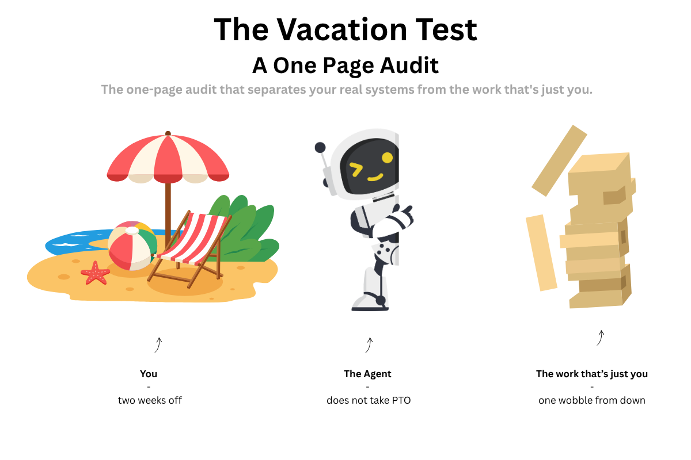
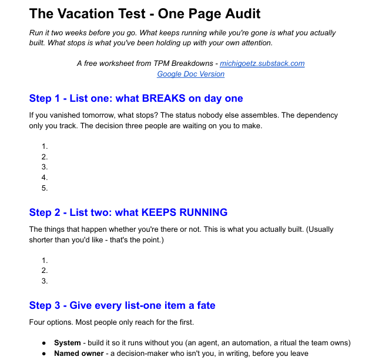

# 🌴Your vacation is a systems audit. Most initiatives quietly fail it.

**The Seat #02** | *The most honest audit your program will ever get runs itself every summer. What keeps working while you're gone is what you actually built.*

*Michi Goetz - August 2026*

---

*This is **The Seat -** a new strand this substack on the craft of working in software engineering itself: the permissions, the org design, the career calls nobody hands you, and how to build TPM and engineering organisations. [Practical AI](https://michigoetz.substack.com/t/practical-ai) covers the tooling; [💺The Seat](https://michigoetz.substack.com/t/the-seathttps://michigoetz.substack.com/t/the-seat) covers the people. This week about “being on PTO and vacation”.*

It’s the Friday before two weeks off. You wrote the handover doc: fourteen pages, every scenario you could think of. You named three people to call. You board the plane feeling covered.

Day two, the Slack message arrives anyway.

**“Quick one - where do I find the thing?”**

That message is the audit result. Your initiative just told you the truth no maturity assessment ever will: the thing only you know how to do is still only in your head.

Here is the reframe that makes the next two weeks useful instead of stressful. Your vacation is not time away from the system. It is the most honest test the system will ever get. What keeps running while you’re gone is what you actually built. What stops the day you leave is what you’ve been holding up with your own attention, wearing a system’s clothes.

[« ☀️ Download the one page audit vacation test directly here ☀️»](https://michigoetz.substack.com/perks/6fbb0787-f1ff-4e7f-a7c6-a6d2f8ee0281)

### **But being needed is the whole point of the job**

That’s the fair objection, and it’s a trap.

There is a difference between being valuable and being a single point of failure. The senior TPM whose programs stall the week they leave hasn’t proven they’re essential. They’ve proven there’s a load-bearing dependency with their name on it - one nobody priced, including them.

Being needed for judgment is the job. Being needed for the status update to happen at all is a system you forgot to build.

### **The agent doesn’t take PTO. The judgment does.**

Here is where the vacation test connects to everything else in this Substack.

Most of what stops when you leave is exactly the work AI is now good at. The status that only happens because you chase it. The dependency map that’s current only because you keep updating it. The risk scan nobody runs at 4pm on a Friday. Those are systems you can build so they run without you, because the agent doesn’t go to the beach.

What genuinely can’t run without you is the judgment. The decision that needs a human who was in the room. The escalation that needs your read on whose yes actually moves things. The call that depends on a history no document holds.

So the vacation test does something useful for free: it sorts your work into two piles.

- Pile #1: What systems should carry
- Pile #2: What is irreducibly you.

The survey we ran across 252 TPMs draws the same line: the work already being automated - status, summaries, first drafts - is the “keeps running” pile, and the work practitioners most want help with but can’t yet hand off - risk, dependencies, the judgment calls - is the “irreducibly you” pile. Most people have never drawn that line for their own programs, because as long as you’re present every day, you never have to.

### **How to run the test before you’re on the plane**

You don’t have to actually leave to get the audit. Run it on paper, two weeks out.

**List one - what breaks on day one.** Walk your programs and ask honestly: if I vanished tomorrow, what stops? The Monday status nobody else assembles. The dependency only you are tracking. The decision three people are quietly waiting on you to make. Write them down. That list is your single-points-of-failure register, and you just generated it in fifteen minutes.

Mine, a year ago, sat right at the top: the Monday portfolio status only existed because I spent ninety minutes every Monday assembling it by hand, and nobody else could. That was the honest number one on my list - and, not by accident, the first thing I later turned into a system that runs without me.

**List two - what keeps running.** The things that happen whether you’re there or not: the report that builds itself, the ritual the team owns, the dashboard that updates on its own. This is what you actually built. It is usually shorter than you would like.

**Then give every item on list one a fate.** Four options, and most people only reach for the first. Some become a **system** - the status that assembles itself, the risk scan on a schedule, the report an agent drafts from the data. Some get a **named owner** - a decision-maker who is not you, in writing, before you leave. Some just **wait** - low-frequency, low-stakes work that is genuinely cheaper to pause for two weeks than to automate, and forcing a system onto it is how you over-engineer a fix nobody needed. And a few **stay yours**, and that is correct. Those are the judgment calls. The point was never to delegate them. It was to stop pretending the rest was a system when it was just you on a schedule.

**Grab the worksheet.** The two-list Vacation Test is a one-page fill-in - both lists, the four fates, and room for your own items. It's a free subscriber perk:

[« Download here for free »](https://michigoetz.substack.com/perks/6fbb0787-f1ff-4e7f-a7c6-a6d2f8ee0281)

### **If you lead the team, run it on the org**

The test gets sharper one level up. When your report goes on vacation and their programs stall, that is your org’s single-point-of-failure audit - and unlike an individual, you can actually act on it. Redistribute the knowledge. Fund the documentation. Name a backup. Hire against the gap.

Every vacation on your team is a free single-point-of-failure report you never had to commission. Most managers waste it, because the person’s programs limp through, everyone exhales when they’re back, and the gap goes unwritten. Don’t exhale. Write down what stalled while they were gone. That is your team’s real backlog, and it audited itself for free.

### **What the test won’t fix**

Two honest limits, because a clean framework always oversells.

**Some single points of failure can’t be closed in two weeks, and faking it is worse than naming it.** If you are the only person who understands the legacy integration, a rushed handover doc doesn’t transfer that knowledge - it just documents that the risk exists. Writing “if I’m unreachable, this is the gap” is more useful than fourteen pages nobody will open.

**Building for your absence is not the same as checking out.** The goal is not to make yourself replaceable so you can coast. It is to make the machine carry the mechanical load, so that when you are there, you spend your attention on the judgment only you can bring. Absence-proofing is a leadership move, not a disappearing act.

### **The Monday action**

You don’t need a vacation booked to run this.

Today, take fifteen minutes and write list one: what breaks on day one of two weeks off. Don’t fix anything yet. Just look at it. That list is the most honest backlog you’ll generate all year - every item is either a system you haven’t built or a decision you haven’t handed off, and now you can see which is which.

Then do the kind thing for the version of you who eventually does get on the plane: build one of them into a system before the summer ends. Let the agent cover the part that was never supposed to be yours. The one-page Vacation Test worksheet walks the whole audit - both lists, the four fates - and it’s a free subscriber perk: [worksheet link - add before publish].

And the permission, because this is the season for it: you are allowed to be actually unreachable. Not “slow to respond.” Not “checking mornings.” Unreachable. The program that can’t survive that isn’t proof you’re essential - it’s the audit telling you what to build next.

## **What’s next**

The vacation test is one audit that runs itself, whether you want it to or not. Next in the series: the audit you run on purpose - a launch-readiness agent that scored a real go/no-go, and the meeting that happened when it came back NO-GO.

Let’s build

Michi

---

*Originally published on [TPM Breakdowns](https://michigoetz.substack.com/p/the-vacation-test), Aug 5, 2026.*
