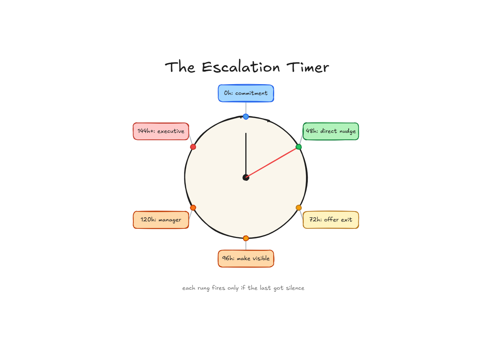
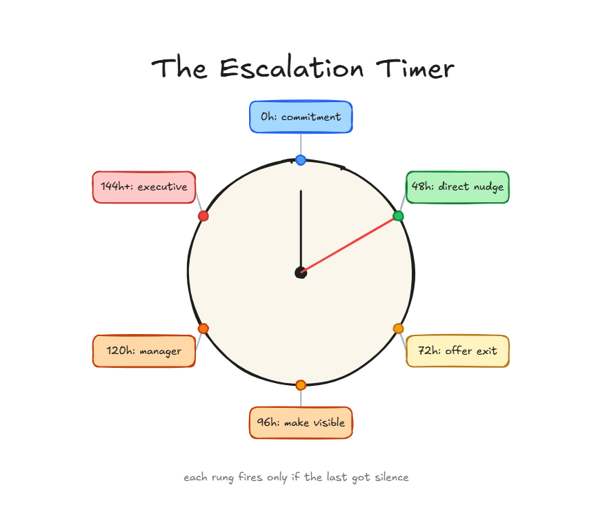

# Escalation isn't tattling. It's a timer.

**The Seat #03** | *A 48-hour timer and a ladder that move a stalled dependency without burning the relationship, and the senior move most people skip: making the next one unnecessary.*

*Michi Goetz - August 2026*

---

*This is **The Seat -** a new strand of this Substack on the craft of working in software engineering itself: the permissions, the org design, the career calls nobody hands you, and how to build TPM and engineering organisations. [Practical AI](https://michigoetz.substack.com/t/practical-ai) covers the tooling; [💺The Seat](https://michigoetz.substack.com/t/the-seathttps://michigoetz.substack.com/t/the-seat) covers the people. This week is about escalating the right way.*

Your launch depends on one change from the platform team. A new field on an endpoint that three of your services read. The Platform Lead committed to shipping it by end of week. That was two weeks ago. You sent one friendly ping and heard nothing back.

**So you wait another week.**

Not because waiting is smart. Because the alternative feels like tattling.

That instinct, the one that reads escalation as a complaint about a colleague, is the most expensive habit a TPM, PM or Software Engineer can have. Every week you sit on a blocked dependency out of politeness, the slip compounds somewhere you can’t see. And when it finally surfaces, the question is never “who didn’t respond.” It’s “why didn’t you flag this sooner.”

You had the information three weeks early. You just couldn’t make yourself use it.

### **But escalating means I couldn’t handle it myself**

Name the belief underneath it. Escalation feels like an admission that you lost control and now you’re running to a manager.

**It isn’t.** Absorbing a blocker that isn’t yours to absorb is not control. It’s the opposite. It makes you the single point of failure the program routes around when you go quiet. Escalation is not a complaint. It’s a decision made visible: you’re telling the org that a commitment it’s counting on didn’t happen, and asking the person who can move it to move it.

The healthiest cultures already treat it this way and say so plainly: **raising a blocker early is the job.** The unhealthy ones treat it as failure, and you can spot them, because problems bounce around the bottom for weeks until they hit the top as a fire instead of a flag. If escalating in your org truly gets you punished, that’s real, and bigger than this article. For the rest of us, the danger we imagine mostly isn’t there. We’re the ones holding the flag down.

### **First, the filter: impact, not frustration**

One test decides whether a blocker is even worth raising. Not how annoyed you are. What it blocks. If a missed commitment only costs you a tidier week, absorb it. Reroute, adjust, handle it. That part is actually yours.

If it blocks the program, a launch date, a downstream team, a contract, it stopped being yours the moment it went past a deadline someone else owns. Sitting on it is not patience. It is you deciding, quietly and alone, to accept a risk that was never yours.

Two ways to get this wrong, same cost. Escalate everything and you become the person whose alarms nobody reads. Escalate nothing and you carry risk that was never yours while the blast radius grows. Both come from not being sure how bad it is. So set your bar while you’re calm, so the frustrated version of you doesn’t get a vote.

### **The 48-hour rule**

Most blockers never need to go up the chain at all. The default is lateral, you and the person, directly. Going direct clears the large majority of stalls, and the whole ladder below exists only for the ones it doesn’t.

So start a clock. When someone commits and 48 hours pass with no follow-through, a timer starts. Not an escalation. A timer. The clock decides now, not your mood, and you never again wonder whether it’s “too soon,” because the clock already knows. The 48 hours is a floor, not a law. Scale it to what’s at stake: a P0 blocker starts the clock in minutes, a nice-to-have dependency can wait days. You just never move slower out of fear.

From there, escalation is a ladder, not a jump. You climb one rung at a time, only when the last one gets no response. Each rung is more visible than the last, and each still assumes the person is swamped, not malicious, until the evidence says otherwise.

### **The Ladder**

The Platform Lead committed to shipping the endpoint change by end of week.

**Hour 0: The Commitment.** “I’ll ship the new field by Friday.” Write it down. A commitment you didn’t record can’t be missed on a clock.

**Hour 48: The Direct Nudge.** No public anything yet. A direct message: *“Hey, still planning to ship by Friday? Anything blocking you?”* Half the time it ends here. People forget, and a nudge is a favor, not an escalation.

**Hour 72: Assume good intent and offer the exit.** Still nothing. Direct, private, generous: *“I know you’re swamped. Can I help unblock anything, or should we push to next week and adjust the timeline?”* This rung is the one that keeps the bridge intact. You are not saying “you failed.” You are saying “what’s blocking you, how can I help.” If it moves here, nobody lost face.

**Hour 96: Visibility.** People skip this rung, and skipping it is why escalations feel personal. You don’t jump to a manager. You make the blocker visible in a shared channel, factually, no blame: *“The endpoint change has been blocked since Monday. Dana (Platform Lead), can you give an ETA? It’s holding three teams from integrating.”* Visibility itself moves most things. Nobody wants to be the named blocker in standup, and you got there without accusing anyone.

**Hour 120: Manager involvement & Decision Making** This is where people escalate badly. They forward a mess and expect the manager to reconstruct it. Don’t. Write the note you want the manager to act on in one read: *“Need your help. We’ve waited on Dana (Platform Lead) for the endpoint change since last Monday, three follow-ups, no response. It blocks our launch. Can you help prioritize?”* Two things make it land clean. Tee up the decision: if you know what you want to happen, say it, and draft the message you’d want them to forward. And protect their exposure. Leaders escalate slowly when they feel exposed, because the stalled team might be their own. Frame it as a shared timeline risk, not a case you’re building, and they move.

**Hour 144++: Executive Intervention.** Rare, and it should be. Both managers, framed as timeline risk, not grievance. By the time you’re here, no reasonable person reads it as you failing. They read it as you managing the program exactly right.

One thing to watch: the signal degrades as it climbs. Three retellings later your risk is vaguer, or it’s quietly become about a person. That’s why you hand up a clean, written ask at every rung, to keep the problem about the risk on its way to someone who can act on it.

### **Escalate to eliminate, not to repeat**

Here is the move that separates a senior TPM from a good one, and almost nobody writes it down.

Run that ladder cleanly and the change ships. But if you’re running it again next month, same team, same kind of stall, escalation stopped being the fix. It became a habit that hides one.

There are two ways to relate to escalation. The immature one treats it as heroism: something’s on fire, you send the email that saves the day, the org thanks you, and the same fire returns next quarter. The senior one treats a repeat escalation as a defect, a decision that keeps not getting made, and builds the thing that makes it automatic. An objection deadline: “unless we hear objections by Friday, the plan of record is X.” A decision log so nobody relitigates a call you won. A single named owner so the next stall has an address. And the cheapest move of all, one a reader of the original taught me: agree the escalation path with your stakeholders before you need it, so climbing it is the plan everyone signed up for, not a surprise.

The best escalation is the one that never had to happen, and that’s the cruel part of the craft: it’s invisible. You can demo a feature. You cannot demo the launch that didn’t slip because you built the forcing function that killed the risk three weeks early. Nobody claps for the fire that didn’t start. But that’s the work, and it’s the difference between a TPM the org needs in the room and one who became the room.

### **Three honest limits**

**The ladder assumes good intent, and sometimes that’s wrong**. Most stalls are overload, not obstruction. But when you can see someone is deliberately sitting on your dependency, the ladder still works, just faster: compress the hours into a day.

**Visibility has a cost.** Naming a blocker in a shared channel stings even when the wording is neutral. Usually it’s worth it, but if the person is one bad week from burning out, a private *“I’m about to raise this in standup, wanted you to hear it from me first”* buys the visibility without the ambush. The ladder tells you when and how far. It can’t read the temperature of the room. That’s still yours.

**Sometimes the stall isn’t overload, it’s politics above you.** The other team outranks yours, or your own manager would rather it stayed quiet because raising it exposes a peer. The ladder still applies, but the win changes: put the risk in writing, keep it about the timeline, and let the paper trail carry what you can’t say out loud. You may not move it. But a documented, ignored risk is a far better place to stand than one you swallowed in silence.

### **Wait? And what about AI?**

One thing I left out on purpose. AI is quietly changing this on both sides: generating more things that need escalating, and, built right, catching them before you ever raise a hand. That’s a different article, and it’s the next one.

You’re allowed to escalate. You were always allowed. The Platform Lead isn’t waiting for you to be patient. The program is waiting for you to be clear.

Something to address more broadly in a Practical AI article.

Let’s build

Michi

---

*Originally published on [TPM Breakdowns](https://michigoetz.substack.com/p/escalate-without-burning-bridges), Aug 19, 2026.*
