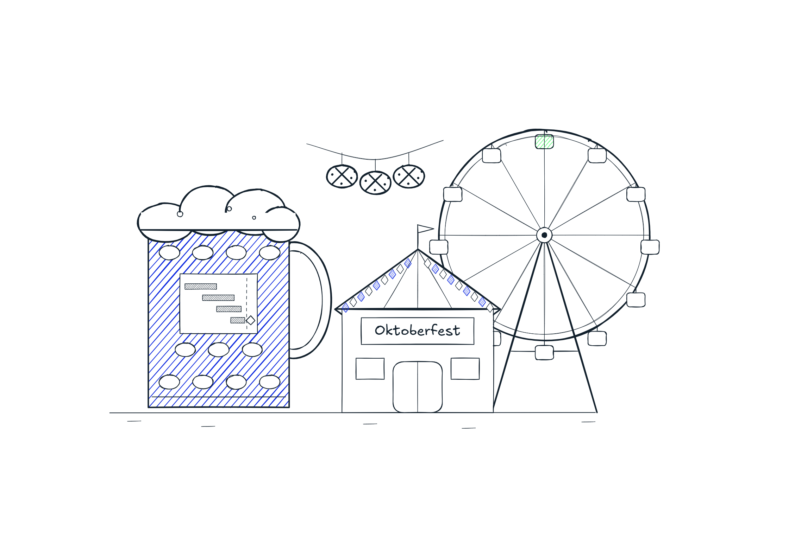

# 🥨🍺🎡 If your tech org ran like Oktoberfest

**The Seat #04** | *16 days, 6.5 million guests, one rule nobody breaks. 10 Wiesn rituals you can reuse in your programs, each with a one-line takeaway and an artifact.*

*Michi Goetz - September 2026*

---

If you have been subscribed for a while, you know that for special days across the year I write about how this relates to programs and initiatives that we are conducting in the tech world. Special posts like this are about **🎃**[Halloween](https://michigoetz.substack.com/p/if-being-a-technical-program-manager), **🎅**[Santa](https://michigoetz.substack.com/p/is-santa-the-og-technical-program), or **🛒**[Black Friday.](https://michigoetz.substack.com/p/if-being-a-technical-program-manager-be0)

This post can also be read as a tribute to where I was born: Bavaria, Germany. I grew up in the Bavarian countryside (yes - where people wear Lederhosn throughout the year), studied in Munich and have been enjoying Oktoberfest multiple times since my childhood. Last week I was back in Munich and brought back this post with some insights and how close the operations are there to building products.

If you’ve only seen Oktoberfest on postcards: locals call it the Wiesn (the meadow), after the Theresienwiese, the huge open field in the middle of Munich where it takes place. There are 17 big beer tents, each seating thousands, plus rides, food stalls and a historic section. Entry to the grounds is free. The beer comes in one-liter glass mugs, and that mug is called a Maß (pronounced “mass”, German readers know that there are jokes on pronounciation). Oktoberfest originated on October 12, 1810, as a massive public wedding celebration for Crown Prince Ludwig of Bavaria (who later became King Ludwig I, he is *not* the one who built Neuschwanstein) and Princess Therese of Saxe-Hildburghausen. It actually starts in September and as history tells to take advantage of Munich’s warmer weather and longer daylight hours in late September (can confirm this, blue skies in Bavaria hit different in September and weather is also warm).

This year, on Saturday, 19 September, at 12:00 sharp, the Mayor of Munich tapped the first keg in the Schottenhamel tent and shouted “O’zapft is!” (Bavarian for “It’s tapped!”). Until that moment, no other tent on the Theresienwiese was allowed to pour a single beer. Staff on shift, kegs cold, benches full since 9:00. Everyone needs to wait to have a beer.

Let us deep dive into 10 facts and how they relate to program execution in Tech.

[Last year](https://www.muenchen.de/en/events/oktoberfest/numbers-records) the Wiesn served roughly 6.5 million Maß to roughly 6.5 million guests. This is the 191st edition. Most programs I see run with fewer rules and more chaos.

*Wondering why there are no photos? New this year, the city charges a licence for content shot on the Wiesn for commercial use, and a newsletter with a paid tier can count. I took plenty. They stay on my phone. The rule names the trigger instead of banning the camera, which is ritual number eleven if you’re counting.*

### **1.🚪 Seiteneingang (side entrance): skip the main gate**

Tourists queue at the Haupteingang (main entrance). Locals walk in through a side entrance. This year the city even runs a [“How to Wiesn”](https://www.oktoberfest.de/en/magazine/oktoberfest-news/heres-midpoint-report-oktoberfest-2026) campaign telling visitors to use other entrances and come on weekdays. It’s working: weekday visits are up 18.5 percent.

Programs have a Haupteingang too: the steering committee. Everyone pushes their decision through it at the same time, and it jams.

Most decisions don’t need the main gate. They need a 15-minute 1:1 with the right person before the big meeting, so the big meeting only confirms.

*If the decision happens in the steering committee, you walked in the wrong gate.*

Artifact: Pre-read and 1:1s with each decision owner before every steering committee

### **2. 🍺 O’zapft is (It’s tapped!): one gate, nobody jumps it**

The [tapping ceremony](https://www.oktoberfest.de/en/information/events/oktoberfest-tapping-and-opening-ceremony) has run since 1950. After the Mayor’s shout, twelve gunshots signal that every other tent may now start pouring.

One owner, one time, one public signal. Every tent is ready before noon. Ready doesn’t mean allowed.

In programs, teams ship when they’re ready and the launch is whatever happened. Customers find the feature before support does.

*Being ready early earns you nothing except waiting.*

Artifact: Launch gate card (gate owner, go time, go signal, who gets told)

### **3. 🙅 The tent is full: the doors close**

You don’t need a reservation. You walk in while there’s room. When the tent is full, the doors close. Nobody adds a bench. The official advice is to walk the Schaustellerstraße (main street) or my personal tip is to head to the [Oide Wiesn](https://www.oktoberfest.de/en/the-oide-wiesn) (Old Wiesn), a quieter historic section with vintage rides and a small entry fee. There is also a Limobrunnen (or soda fountain) for kids which comes later in this post.

*“Can you squeeze it in” is how you get a tent where nobody gets served.*

Artifact: Team intake policy with a capacity limit and a named redirect.

### **4. Italienerwochenende (Italian weekend): the peak you can see coming**

The middle weekend of the Wiesn has been [Italian for decades](https://www.euronews.com/2026/09/26/oktoberfest-wiesn-closure). Tens of thousands of Italians come to Munich and swamp the Octoberfest. Nobody declared it. The press office calls it a name that grew historically, not an official one. Everyone plans around it anyway.

Officers from the Polizia di Stato and the Carabinieri patrol with the Munich police. Firefighters from Bolzano help out. Tents put out Italian menus and specific bus tours are organized from Italy. Fun Fact: Growing up, I heard the traffic warnings on Bavarian radio read in Italian that weekend (greetings go out to Antenne Bayern)

None of that is improvised on Friday. The date is known a year ahead, so the capacity is planned a year ahead.

Every company has its Italienerwochenende: Company Customer Events like Dreamforce or Celosphere, Prime Day, the holiday freeze, quarter end. Same dates every year. Same surprise every year.

*A peak you can predict and still don’t staff is a planning failure.*

Artifact: Annual peak calendar in the program plan | Surge playbook per event (freeze window, extra on-call, comms in the customer’s language)

### **5. 🗼 The coordination desk: someone watches the field**

[New in 2026](https://stadt.muenchen.de/news/oktoberfest-2026-sicherheit-und-kontrollen.html): a coordination desk in the service center where police, city and organizers watch visitor flows together and flag overcrowding early. For 190 editions, each tent managed its own door.

The desk came after the crush. Last year the whole grounds had to close twice because of overcrowding. That desk pours no beer and owns no tent. Its job is the space between the tents. That is where dependencies, coordination and alignment is necessary.

*Every org hits the size where someone has to watch the field instead of a tent. Most add the desk after the crush.*

Artifact: Cross-team dependency map maintained continuously.

### **6. 🍋 Limobrunnen (soda/lemonade fountain): self-serve for the small asks**

Inside the Festzelt Tradition (Tradition festival tent) on the Oide Wiesn is a [lemonade fountain](https://elederhosen.com/blogs/oktoberfest-and-festivals/festzelt-tradition-oide-wiesn?srsltid=AU7gw4Wh7yuG1daf95XBYs0e2tPdQ_OHimZXFSaN9iJrcYSQLy__lA0r). Kids pay one euro and tap as much as they want. No Bedienung (waitstaff), no waiting, no ordering one glass at a time. Just: **€1 unlimited soda for kids.**

The Bedienung stays free for the Maß and the Hendl (half a roast chicken, the Wiesn staple). The kids stay happy. Nobody loses.

Most of us run it the other way. Every “what’s the status,” “who owns this,” and “where’s the doc” goes through the same person who makes the go/no-go call. The small asks eat the time the big calls need.

*If the smallest request waits in the same line as the biggest, you’ve designed the queue wrong.*

Artifact: Self-serve program page (status, owners, decision log, links) | Agent that answers the top 10 repeat questions

### **7. 😈 Teufelsrad (Devil’s Wheel): speed throws off the edge, the ball knocks off the center**

The [Teufelsrad](https://www.oktoberfest.de/en/attractions/rides/feldls-teufelsrad) has been on the Wiesn since 1910. Everyone sits on a wooden disc. The disc spins up. Whoever sits at the edge flies off first. Whoever fights their way to the center stays on, until the Rekommandeur (the barker on the microphone who runs the show) swings a ball on a rope and knocks them off too.

Programs work the same way. When the pace picks up, the edge goes first: the nice-to-haves, the work with a loose owner, the team that joined late. That’s physics, and you can plan for it.

The ball isn’t physics. It’s the exec drive-by, the “quick favor,” the reorg announced mid-quarter. It hits the team at the center, the one that was stable.

*Speed throws off the edge. The ball knocks off the center. Only one of those is physics.*

Artifact: Scope tiers (core vs. edge) agreed before the pace increases | Named intake owner who takes the ball instead of the core team

### **8. 🧳 Fundbüro (lost and found): the latency is on the sign**

The [Fundbüro](https://www.oktoberfest.de/en/information/service-visitors/all-information-about-oktoberfest-fundburo-oktoberfest) moved this year to the Deutsches Museum Verkehrszentrum (the transport museum next to the grounds). Its old rooms went to the coordination desk from #5. Staff in the tents often bring found items the next day, and visitors are told to wait a day or two.

That is an honest SLA. Your status dashboard also runs a day behind. Nobody says so.

*A green tile without a timestamp is a guess.*

Artifact: “As of [date, time, source]” line on every status report

### **9. 💧 ZwiWa (Zwischenwasser, “in-between water”): the water between rounds**

Locals have a word for it. Zwischenwasser, ZwiWa. A Maß of water between two Maß of beer, ordered before you need it, not after the bench starts spinning. Wiesn beer is brewed stronger than normal beer, around 6 percent, so it matters.

Programs run launch into launch into launch. The recovery week gets planned when someone burns out, if it gets planned at all.

*If you don't schedule the recovery, burnout will schedule it for you.*

Artifact: Cooldown sprint on the roadmap after every major launch | No-launch weeks in the release calendar

### **10. 🛝 Toboggan (my favourite): let go of the rail**

The [Toboggan](https://www.oktoberfest.de/en/attractions/rides/the-toboggan), a wooden tower slide, has been on the Wiesn since 1933. A conveyor belt carries you 8 meters up the tower, and you slide down on a sack. The slide takes seconds and nobody falls. The belt is the ride, and the crowd outside is there to watch it.

The technique goes against every instinct: lean your upper body forward, let go of the handrail, no jumps, no turns.

Everyone grabs the rail. The rail stands still, the belt moves, and your feet go one way while your hands go the other. That’s the fall the crowd is waiting for.

Rollouts fail the same way. The team adopts the new tool and keeps the old spreadsheet “just in case.” The new process runs next to the old status meeting. Half the work lives in each system, and nobody commits to either.

The Toboggan staff stand at the belt, not at the slide. They hold hands and grab coats at the first step, where the falls happen.

*Lean in, let go of the rail, and put your people at the first step.*

Artifact: Switch-off date for the old process announced before go-live | Support staffed at the first real task, not at the training

### **My takeaway**

The Wiesn doesn’t run on heroics. A noon rule, a door policy, a peak on the calendar a year ahead, a desk watching the field, water between rounds, and staff at the belt. Boring on purpose, so the party doesn’t have to be.

Pick one ritual. Run it next week. The Wiesn runs until 4 October, so you still have time to test it with a Maß in hand.

Which one is missing in your program? Tell me in the comments.

Prost!

Michi

---

*Originally published on [TPM Breakdowns](https://michigoetz.substack.com/p/oktoberfest-program-management-lessons), Sep 28, 2026.*
