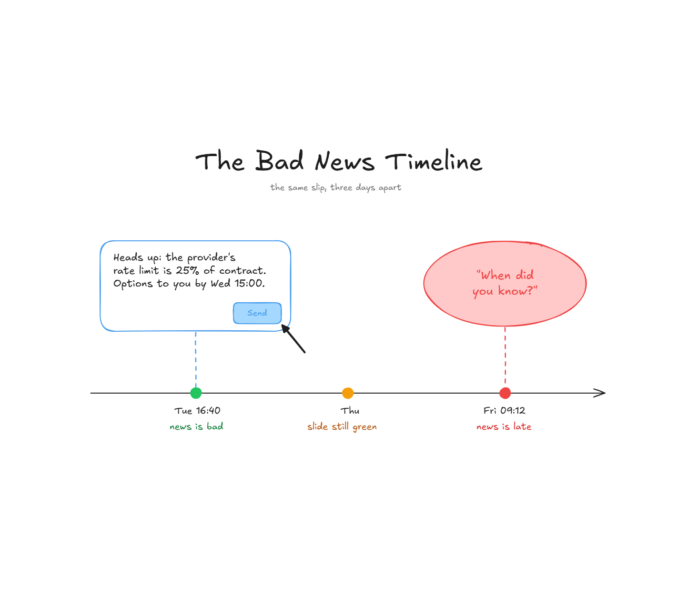

# 🚩Bad news doesn’t hurt your credibility. Late news does.

**The Seat #05** | *How to take bad news to your boss when it is not your fault. The 5 questions they will ask and the one that’s answered before you walk in.*

*Michi Goetz - October 2026*



---

Everyone has been there. The message is already typed. Something like

*“Heads up: the payment provider’s rate limit is 25% of what the contract says. At launch volume, checkout breaks on Day 1.”*

Tuesday, 16:40 (or 04:40 PM): Maybe the load test just came through and the launch is nineteen days out. Your cursor is on Send. But you do not press it. Not because you are hiding anything. Because it might be a sandbox setting, because the provider might fix it tomorrow, because you don’t want to be the person who pulled the alarm over a config file.

You will get the full picture first. You delete the message (or keep it in your Gmail / Slack drafts).

Thursday, in a portfolio review with leadership it is pulled up: *“Payments, 🟢, on track for launch”* and you still do not have the full picture. Friday morning, you get an email forward from the enterprise architects. The load test hit the same wall at a customer deployment.

The “quick alignment call” or “Slack chat” is being established and it is not about the rate limit, not about who signed the contract. They ask one thing:

***“When did you know?”***

The answer is Tuesday and the conversation stops being about the provider.

A note on AI: it can surface this kind of signal sooner and help you make sense of it. This is what *[Practical AI](https://michigoetz.substack.com/t/practical-ai)* covers. This piece is about the part AI doesn’t remove: the conversation after you know.

### Why everyone waits

In 1970, psychologists [Sidney Rosen and Abraham Tesser](https://doi.org/10.2307/2786156) invited people in to compare deodorants. While they worked, they overheard a message: a man named Glenn Lester should call home immediately, there was some very bad news. For the other group, very good news. Then Glenn Lester walked in…

With good news, nine people passed it on straight away. With bad news, two did. The rest took longer, or said to call home and left out that the news was bad. Both groups felt just as responsible for passing it on.

And the researchers had stripped out every obvious reason to stay quiet. No history with the recipient, no relationship to protect, no reward for telling, no punishment for keeping quiet. The effect held anyway. Rosen and Tesser called it the MUM effect: keeping **M**um about **U**ndesirable **M**essages. Nobody in that room decided to hide anything. They decided to wait and when they did speak, they left out the part that mattered.

That’s Tuesday, 16:40, just a deodorant study instead of the load test results. Now add a job where you own the outcome but not every part that produces it. That’s most jobs in tech:

- **Product Manager:** Engineering finds the feature is twice the size and it’s your launch date marketing already announced
- **Technical Program Manager:** Another team’s dependency slips and it’s the program going red
- **Engineering Manager:** A key engineer leaves mid-sprint and it’s your team’s commitment that breaks
- **Tech lead or Software Engineer:** The library you chose can’t scale and it’s your estimate that was wrong.

Different seat, same walk. And as Stanford’s [Bob Sutton](https://www.psychologytoday.com/us/blog/work-matters/201006/the-mum-effect-and-filtering-in-organizations-the-shoot-the-messenger) puts it, bearers of bad news, “even when they aren't responsible for it in any sense, tend to be blamed” (Shoot the messenger - everyone knows this in tech).

Your boss cannot watch most of your work, they can watch the 48 hours after something breaks. In review season that is the part they remember (sad, but true, achievement log as mitigation, but that is another post)

Here are five questions they’ll ask, in order and it might help you to navigate this challenge.

### 1 - “When did you know?”

Waiting feels like diligence. “I’ll have the full picture by Thursday” sounds responsible. It is not.

Your boss does not need the full picture. They need to stop being the last to know. The message you deleted on Tuesday was the right one. It was missing one line:

*"Heads up: the provider's rate limit is 25% of contract, which breaks checkout at launch. **Options to you by 15:00 Wednesday.**"*

A surprise is not bad news arriving. It is bad news arriving after someone acted on the old version.

### 2 - “How bad is it?”

Forty years after Glenn Lester, J[ayson Dibble and Timothy Levine](https://www.tandfonline.com/doi/abs/10.1080/10510974.2013.770407) found the bias runs in both directions: we are slow to pass on bad news and quick to pass on good news. A status report has both built in. The green rows go out on time. The red one waits for the full picture.

So red first, even when it’s one row out of eight. Reporting in template order is how you grow the [watermelon](https://michigoetz.substack.com/p/the-program-fruit-bowl-an-anatomy) 🍉.

And translate: “Rate limit is 25% of the contract” is accurate and useless upstairs. “Checkout fails for three in four transactions on launch day, across forty customers” is something you can repeat and everyone can understand it.

### 3 - “Whose is it?”

Over-own it and you’ve made it yours to fix when it needs more authority than you have. Under-own it and you sound like you are building a case.

The advice here is to split it:

- **What happened?** The fact, no adjectives
- **Whose is it?** Ownership, not blame and keep it neutral
- **What was yours?** There’s almost always something, like a load test run at T-19 instead of T-45. Name it and name what you changed

That third line is what builds trust and credibility.

*Another team’s commitment slipping is an escalation and this is a different conversation as outlined in Seat #03.*

### 4 - “What do you need from me?“

Two or three options, one line trade off for each, your recommendation or pick and a date by when a decision is needed. This sounds then like “Slip 9 days, recommend it, need your call by Friday” turns the “program is in trouble” into a decision only your boss can potentially make. Same move as the [NO-GO in 2026.AI.17](https://michigoetz.substack.com/p/launch-auditor-agent-skill-no-go): the decision gets made on purpose, in writing, by a human.

### 5 - “Should I believe you?”

They never say this one out loud. Researcher Michael Cuellar studied what he calls the [deaf effect](https://scholars.georgiasouthern.edu/en/publications/the-deaf-effect-response-to-whistle-blowing-in-the-deaf-effect-re-3/) in troubled projects: the decision maker hears the bad news, then carries on with the failing plan anyway. In his experiments it showed up when two things came together and the messenger did not seem credible and the risk looked low.

Question 2 is how you make the risk look its real size. This question is about the other half.

So credibility is a balance, but built in the boring weeks of programs. The early yellow that mattered, the number that held from an early risk that was raised or a green that meant to be a real green. Someone whose last three yellows (or ambers) were right gets heard on the first red. One who was green for six months gets *“Let us not overreact”.*

### So what’s the message?

In summary, the full message template can look like this:

```
Subject: [Program] - [risk] - decision needed by [date]

What happened:  [one sentence, fact only]
What it means:  [dates, customers, or money]
Whose it is:    [owner, not blame]
What was mine:  [what I missed] -> [what I changed]
Options:        A) ... B) ... (one-line trade-off each)
I recommend:    [option], because [reason]
I need:         [decision] by [date]
```

It answers questions 1, 2, 3, 4. Nothing answers question 5 except the weeks before.

### Two honest limits

**Some bosses shoot the messenger:** Send it anyway, in writing as a documented early warning is a better place to stand than a slip you swallowed.

**Early isn’t always better:** Flag every flicker and nobody reads your alarms. Therefore, flag on impact and not anxiety.

So what to do?

Your “Monday action” could be to find the row that’s green on paper and yellow in your head. Investigate and send your boss or peers three lines about it before your next meeting or in a Slack channel. The bad news still was not yours, but the timing was and the timing is what is being remembered.

Have a great week ahead!

Let’s build!

Michi

---

*Originally published on [TPM Breakdowns](https://michigoetz.substack.com/p/how-to-deliver-bad-news-to-your-boss), Oct 19, 2026.*
