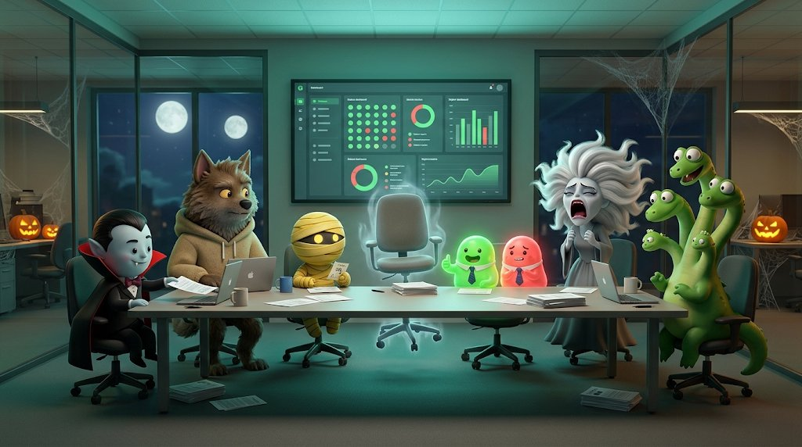
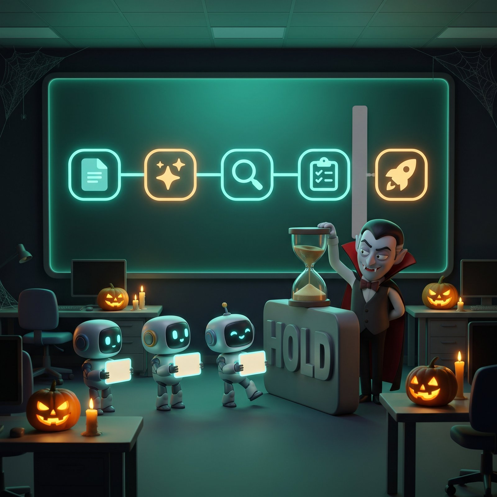
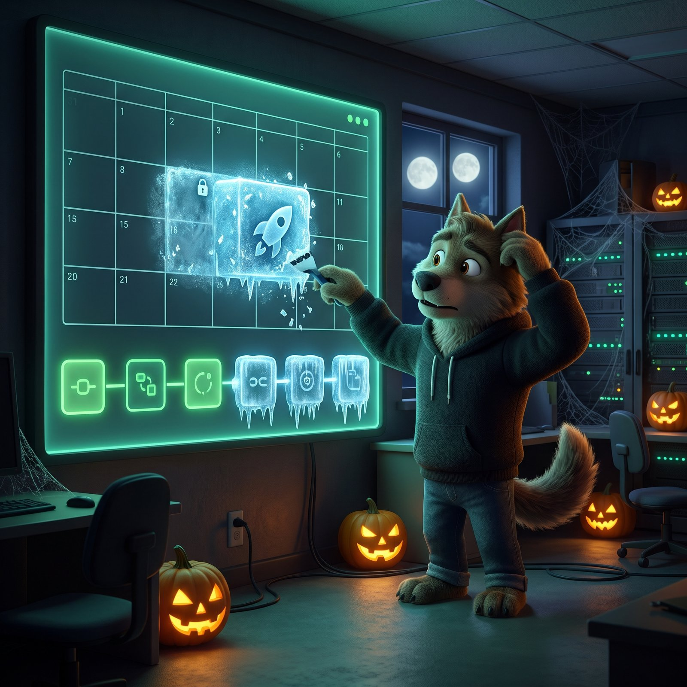
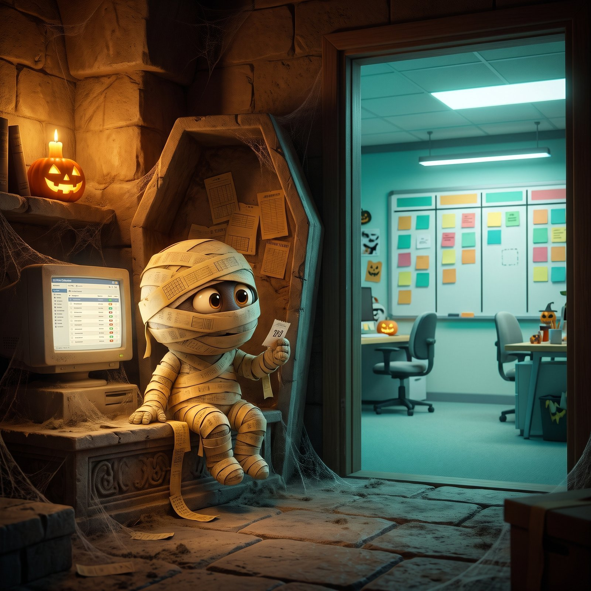
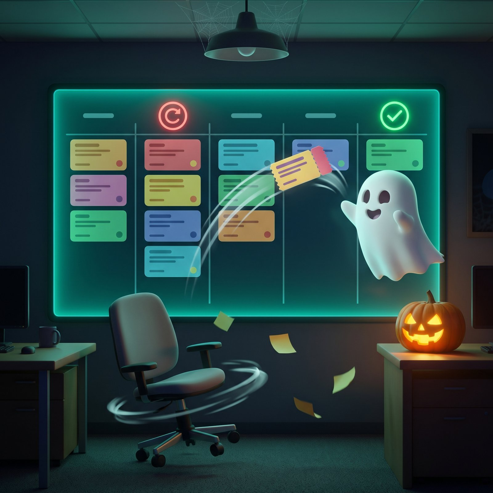
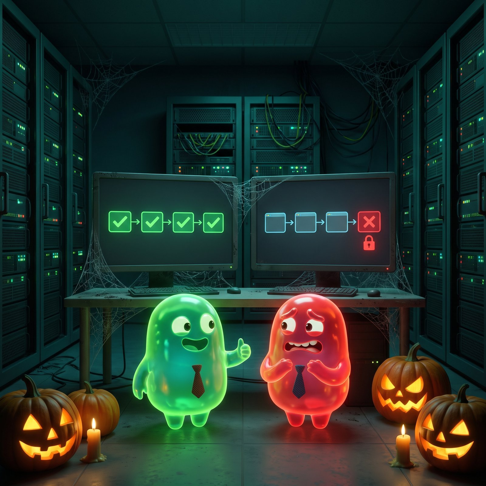
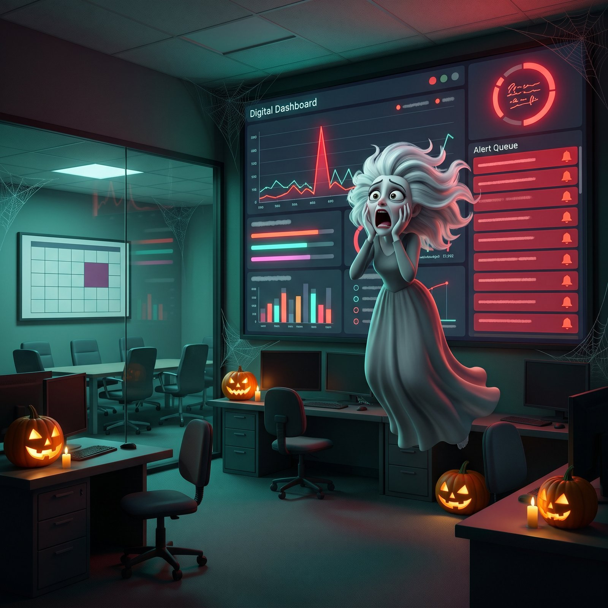
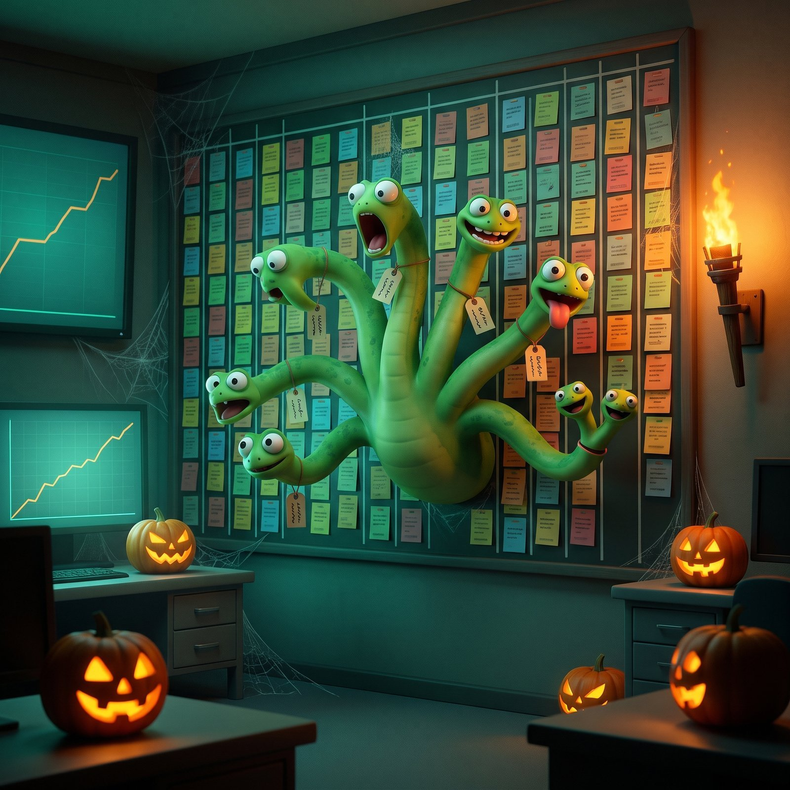

# 🎃🧛🐺 Seven program monsters that look perfectly reasonable

**The Seat #06** | *Happy Halloween! They don't jump out at you. They get approved, logged and marked green. How each one got in, and the one line that keeps it out.*

*Michi Goetz - October 2026*

---

It's that time of year!! Happy Halloween to all of you! 🎃

The scariest monsters in software programs don't jump out at you. They get in because everything about them looks reasonable.

[Last Halloween](https://michigoetz.substack.com/p/if-being-a-technical-program-manager) I wrote about the famous ones: the haunted backlog, ghost stakeholders, zombie projects. These are seven quieter ones, met in programs since.

You don’t need to run programs to meet them. If you own a product, you’ve met the mummy. If you ship the code, you’ve met the poltergeist. Each one below says who usually meets it first.

This is a collection of stories I've lived through over the last few years, each one a place where a monster showed up.

*A word on the pictures: like last year, they're made with AI. Last year Gemini spelled my cauldron "Caultron". This year the jump honestly moved me. It still took several tries per image, which fits the theme: the output looks perfectly reasonable, so you check it anyway. Last year: Gemini 2.5 Flash Image. This year: Gemini 3 Pro Image. What a year it has been for AI.*

🎁 All seven artifacts and seven AI prompts are bundled in **The Monster Hunter's Kit**, a free PDF for subscribers. The download is at the end of this post. Trick or Treat - but make it tech!

### **1. 🧛 The Vampire Exception: Invited in once. Never asks again.**

*Who meets it first: the software engineers waiting behind the hold, and whoever granted it.*

In the old stories, a vampire can’t cross your threshold unless you invite it in. After that, it comes and goes as it likes.

**The sighting:** a change hold to protect one customer demo, with an end time, an exception channel and everyone’s sign-off. Then a short notice stretched it to a second demo. Nobody re-approved anything. Every team behind the hold was now waiting on a decision nobody had made.

That is how the vampire works. Invited in once, it never has to ask again.

> *An exception you approved once is not an exception you approved twice.*

**Artifact:** Exception register (owner, end date, scope) | Every extension needs an explicit yes from the original approver

**How AI can help:** flag every notice that extends an exception without an approval attached.

### **2. 🐺 The Werewolf Freeze: Two reasons, one freeze. Nobody can say which one he's waiting for.**

*Who meets it first: the product manager who owns the GA date, and the engineering lead who owns the freeze.*

A werewolf is a perfectly normal person for most of the month. Same body, two creatures, and which one you get depends on the moon.

**The sighting:** a blanket freeze landed on a GA date, and the debate went in circles, because nobody could say what the freeze was for. It turned out to be two reasons sharing one calendar entry. Written down separately, each got its own exception rule, and the fight was over.

> *A date with no stated purpose can’t be negotiated. Each named purpose can.*

**Artifact:** Freeze charter with one line per purpose, each with its own exception rule. Bring the ticket breakdown by cause before the debate starts.

**How AI can help:** sort the tickets by cause before the meeting. Don’t trust it to read what the freeze was meant for.

### **3. 🏺 The Mummy Request: Perfectly preserved, sealed in the wrong tomb**

*Who meets it first: the product managers, and anyone who talks to customers.*

Mummies don’t decay. That’s the point. Wrapped, sealed and kept exactly as they were, in a room nobody visits.

**The sighting:** customer feature requests, logged properly in the CRM, some eleven months old, none with a tracker key. Product didn’t work in the CRM, so none reached the backlog. The customer heard nothing for eleven months. For product, the requests never existed.

> *A request the tracker can’t see has been declined. Nobody told the customer.*

**Artifact:** Monthly reconciliation between the CRM and the tracker | Every request without a tracker key gets one, or a written no

**How AI can help:** match requests to tracker items by meaning and list the orphans. Check its matches: a wrong match is a mummy with a “found” label.

### **4. 🪑 The Poltergeist Ticket: Done. Reopened. Done. Reopened. Nobody in the room.**

*Who meets it first: the software engineers who each own a piece of the fix.*

Doors slam, chairs slide across the floor, and every time you look, the room is empty.

**The sighting:** fixed, closed, reopened. Fixed, closed, reopened again. The argument over whose fix it was ran in ticket comments while customers cleaned up by hand.

Then someone declared a formal incident. Not because the severity changed, but because an incident comes with what the ticket never had: one named owner. The ping-pong stopped.

> *When nobody owns it and it keeps reopening, a formal incident is the cheapest owner you can get.*

**Artifact:** Reopen rule: the second reopen of the same fix becomes an incident with a named commander, and nothing closes without a test that would have caught the regression

**How AI can help:** flag every ticket reopened twice and summarize the thread for whoever takes it.

### **5. 🪞 The Doppelgänger: Same pipeline. Only one of them is what the customer sees.**

*Who meets it first: the software engineers who own the pipeline, and every PM reading its status.*

A doppelgänger is an exact double. You only notice when you see both side by side.

**The sighting:** an automated setup step logged success on every run. The next step, granting access, failed every time. Sixteen failures, read as progress, because everyone watched the log that said success. Lined up side by side, it was obvious: the step succeeded, the customer’s outcome didn’t.

> *A layer’s success log is not the customer’s outcome.*

**Artifact:** One end-to-end check per run on what the customer actually sees | Status reports that count outcomes, not completed steps

**How AI can help:** join the two logs and list every run that said success while the customer got a failure.

### **6. 😱 The Banshee Alert: Every alert was right. The review room was empty.**

*Who meets it first: the on-call engineers and engineering managers.*

In Irish folklore, the banshee wails before a death. She is never wrong. Nobody in the stories tries to stop it, because her cry is treated as fate.

**The sighting:** when a problem was finally traced back, the signals had been in monitoring all along. Correct, timestamped, visible. No review looked at them, so they were treated like the banshee’s cry: something that happens, not something to act on.

> *A signal nobody reviews is not detection. It’s a recording of what you missed.*

**Artifact:** Every alert has a named owner and a slot in an existing review | Before adding a new escalation path, check which standing review already covers it

**How AI can help:** list every alert with no action within a week. Give that list an owner, or you’ve built a second banshee.

### **7. 🐍 The Hydra Backlog: Every closed ticket, two new heads.**

*Who meets it first: the engineering teams living in the backlog, and whoever decides what gets funded.*

Cut off one head and two grow back. Heracles only won by burning each stump.

**The sighting:** hundreds of open audit bugs. Every escalation restarted the cleanup, one ticket at a time, until attention moved on. Grouped by root cause, they were a fraction as many problems, and one fix closed dozens at once.

> *Count problems, not tickets. Then burn the stump.*

**Artifact:** Root-cause clustering before anyone staffs the backlog | One owner per problem, not per ticket

**How AI can help:** cluster the backlog by root cause. Each cluster is a hypothesis until an engineer confirms it.

### **Not one curse. Two.**

Last year I wrote: *if a dependency has no owner and no date, it’s a curse, not a plan*. I expected this year’s monsters to prove it again. Only some of them do.

- **Four are missing an owner:** The vampire’s extension, the mummy’s bridge between two systems, the poltergeist’s fix, the banshee’s signal. Nobody was assigned, so nobody acted.
- **Three are missing a definition:** The werewolf freeze had no stated purpose. The doppelgänger counted the wrong thing as success. The hydra counted tickets instead of problems. In those three, everyone was doing their job. They were just doing the wrong job well.

The second curse is the scarier one. A missing owner eventually shows up as silence. A missing definition shows up as progress.

**The honest limit:** none of the artifacts works on its own. An exception register nobody reads is just another mummy. A reopen rule nobody enforces is just another poltergeist. What the artifacts really do is turn an awkward call (declaring an incident nobody asked for, asking what a freeze is actually for) into a rule, so the next person doesn’t have to be brave to make it. Somebody still has to make the first one.

**The same goes for AI:** It is good at the searching: sorting tickets by cause, matching requests, lining up logs, clustering a backlog. It is much weaker at reading intent or conflict, and it can’t decide that an extension was wrong, that a request gets declined, or who owns the hydra. AI can find the monster. Someone still has to hold the stake.

### **Your takeaway**

Pick the monster you recognized fastest. That’s the one in your program, product or codebase right now. If two came to mind, start with the hydra or the mummy: they cost the most. Adopt one artifact, not seven (seven new processes would be a monster of their own). Book 30 minutes before Saturday, find it, and give it an owner or a definition.

🎁 Want a head start? **The Monster Hunter’s Kit** has all seven artifacts as fill-in templates plus seven AI prompts, one per monster. Free for subscribers:

[Get "The Monster Hunter's Kit"](https://michigoetz.substack.com/perks/6a25c931-dda5-43ce-a162-cc7e79937545)

Which one did you recognize? And if you've met an eighth, describe it in the comments. The best one becomes a Note this week!

Happy shipping, and Happy Halloween. 🎃👻

Michi

###### *All images, including the cover, were created with Gemini 3 Pro Image (Nano Banana Pro).*

---

*Originally published on [TPM Breakdowns](https://michigoetz.substack.com/p/seven-program-monsters), Oct 28, 2026.*
