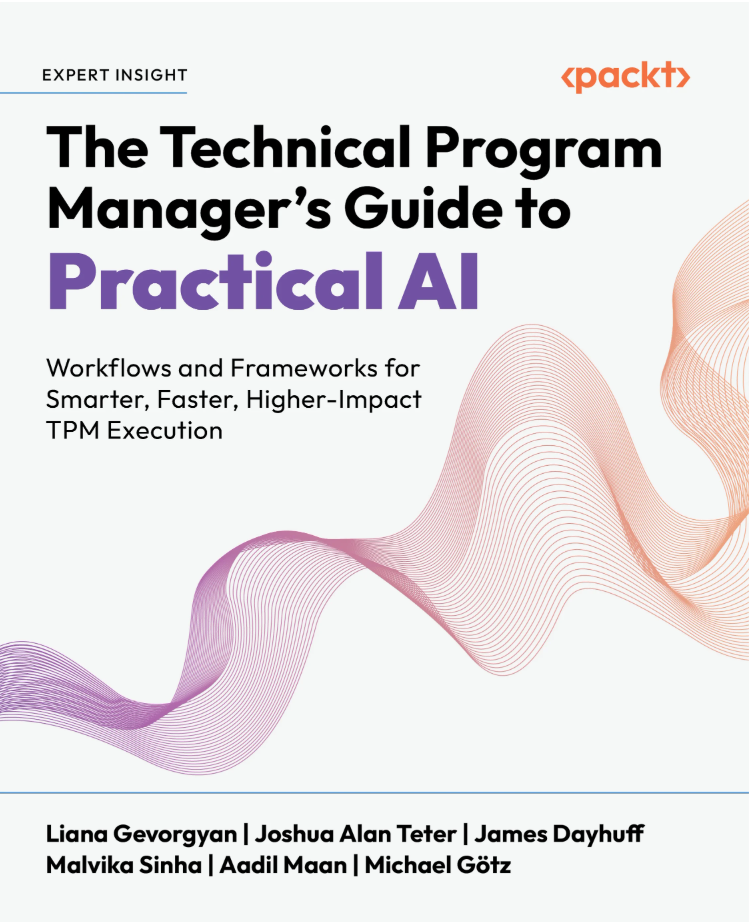
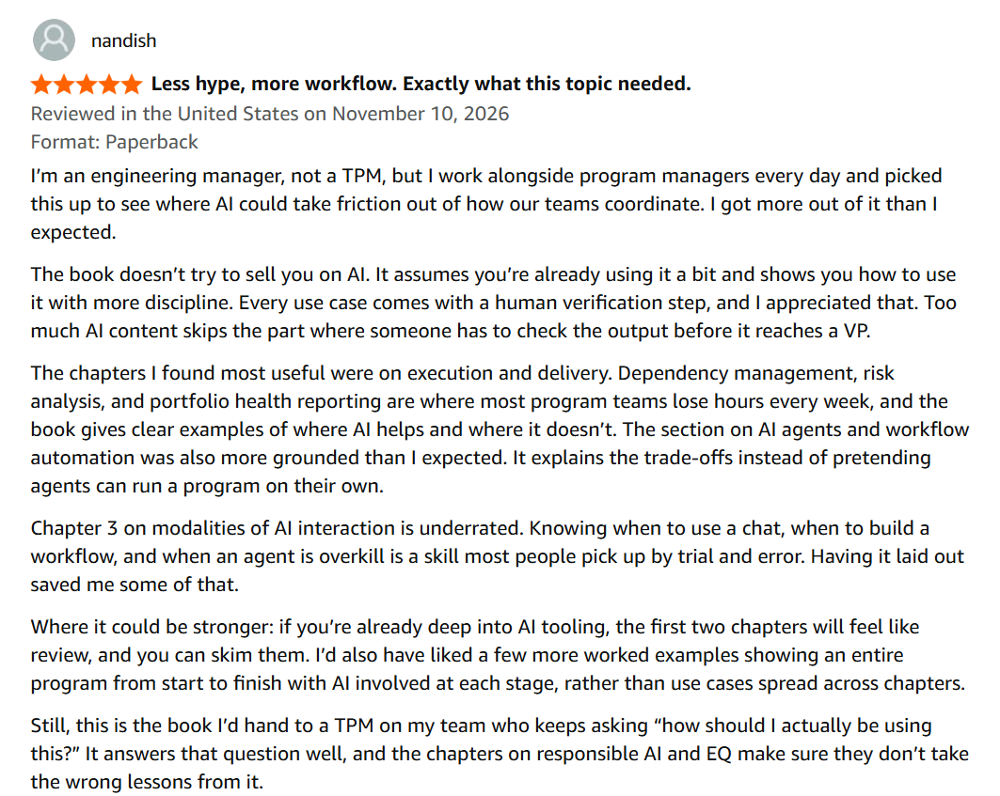
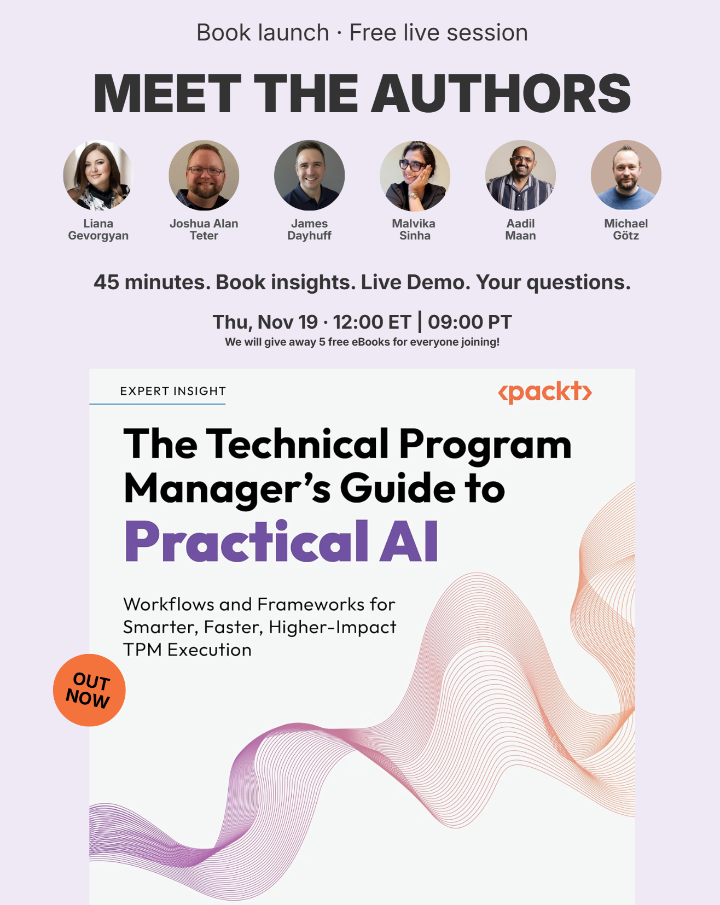

# 🎉 Big News! "The Technical Program Manager's Guide to Practical AI" Is Out

*Available on Amazon and Packt. You can meet all six authors live on Nov 19.*

*Michi Goetz - November 2026*

---

**A year of late nights, six authors, one book: *The Technical Program Manager's Guide to Practical AI* is finally out!**

Where to find it:

- Kindle and paperback on Amazon: **[Kindle](https://a.co/d/08ga5KSB)**, **[Paperback](https://a.co/d/0auAzX6M)** (also on [UK](https://www.amazon.co.uk/dp/1807302636), [DE](https://www.amazon.de/dp/1807302636), [IN](https://www.amazon.in/dp/1807302636))
- eBook and print on Packt: **[Packt](https://www.packtpub.com/en-us/product/the-technical-program-managers-guide-to-practical-ai-9781807302627)**
- Free live session with all six authors, Thu Nov 19: **[Sign up here!](http://www.luma.com/tpm)**

**[Get the book here!](https://mybook.to/PracticalAI4TPMs)**

Thank you Liana Gevorgyan, Aadil Maan, James Dayhuff, Malvika Sinha, and Joshua Alan Teter! I could not have asked for better co-authors.

In its first week it became the #1 New Release in Engineering Project Management on Amazon. Thank you to everyone who ordered early.

My parents taught me to learn by doing. That is how most TPMs I talk to are trying to learn AI, and most of them get stuck at the same first question: "Where do I even start?" In the [State of AI for TPMs survey](https://aifortpms.substack.com/p/state-of-ai-for-tpms-2026) we ran earlier this year (n=252), 63% rated themselves beginner or developing with AI, and 95% wanted to learn more.

The interest is there. The starting point is not. That is what this book is for, and why "Practical" is in the title.

## The main premise of the book

> TPMs work where scale, speed and cross-functional coordination exceed what one person can hold.
>
> AI can take a large part of that load, but only if it runs inside a workflow you can trust.
>
> Every chapter runs the same loop: **inputs → AI assist → human verification → output.** AI takes the assembly. The judgment stays with you.

## In the book, we cover

- **The foundations:** AI concepts, prompting, and agents and workflows, written for TPMs, not ML engineers
- **The program lifecycle:** AI use cases for planning, dependencies, risk, status reporting and stakeholder communication, through to delivery
- **Leadership and career:** AI for TPM leaders, hiring and growing talent, and managing your own career
- **The judgment layer:** responsible AI, evaluating AI tools in an enterprise, and where EQ matters more as AI takes over the coordination work

If you have been reading here for a while, you have seen some of the thinking behind it:

- → [🤖 We asked 252 TPMs, PgMs, PMs, EMs how they use AI. Here's what happened since.](https://michigoetz.substack.com/p/252-tpms-how-they-use-ai) (Jul 29)
- → [🤖 You are not behind on AI. You are two weeks behind.](https://michigoetz.substack.com/p/ai-for-tpms-two-week-ramp) (Jul 15)
- → [Tracker. Orchestrator. AI Architect. Which One Are You?](https://michigoetz.substack.com/p/tracker-orchestrator-ai-tpm) (Mar 31)

## Who is it for?

You.

If someone told you to "use more AI" and gave you no further instructions. In practice that means:

- **TPMs, Program managers and Project managers** who run cross-team work and want AI inside the workflow, not in a side tab
- **Program leads and TPM leaders** who have to decide where their team uses AI, and where it does not
- **Engineering and Product managers** who work next to program people every day. Our first two reviews included an engineering manager, and that was no accident

You need to have run a program, or at least been close to one. You do not need to know how a model works.

**[Get 25% discount with TPM25 on Packt](https://www.packtpub.com/en-us/product/the-technical-program-managers-guide-to-practical-ai-9781807302627)**

## Early reviews of the book

The first two Amazon reviews are in, both five stars, and both went straight to the step we built the book around. Here is Stephen:

> "The framework the author keeps coming back to (inputs → AI assist → human verification → output) is simple, and it's the most valuable idea in the book. It treats AI as something that speeds up your work, not something you hand your judgment to."

That was exactly our intention: AI that speeds up the work without taking the judgment away from you.

And from Nandish, an engineering manager:

> "Too much AI content skips the part where someone has to check the output before it reaches a VP."

## Six authors, one goal

Six authors. Several time zones, from the US to India and Germany. Different first languages, different writing styles, and very different seats: big tech, aerospace, responsible AI, compliance and security, consumer AI products.

It started with a first call around Diwali in 2025 and ran for more than a year of drafts, late-night reviews and long comment threads. We collected real use cases from our own programs and argued over every framework until it held up. Then we had to turn six voices into one book that puts the reader first.

None of us would have written this book alone. And each of us wrote about the launch in our own way:

- **[Liana Gevorgyan](https://www.linkedin.com/pulse/technical-program-managers-guide-practical-ai-what-why-gevorgyan-replc)** on the what, why and how, including how we used AI
- **[James Dayhuff](https://lnkd.in/p/eJ2SWkEu)** on the elephant in the room, did we use AI to write a book about AI?
- **Aadil Maan** on crossing "#9 - Publish a book" off his bucket list: [his post](https://lnkd.in/p/e5Dj8zsH). He writes [The Art of Doing Technical Program Management](https://artoftpm.substack.com/) here on Substack!
- **Malvika Sinha** on a quiet goal that turned into a book: [her post](https://lnkd.in/p/ebzcFa44)
- **Joshua Alan Teter**, author of [*The Technical Program Manager's Handbook*](https://a.co/d/0dooMra9) and founder of TPM Events

Special thanks to [Alessandro Catorcini](https://www.linkedin.com/in/alessandrocatorcini/), our technical reviewer, whose honest feedback made every chapter sharper.

## Talk to us live - We wanna celebrate with you!

We wrote this book for the TPM community, and a book launch should not be a one-way announcement. So we want to meet you.

Bring the program you are running, the AI question you have been stuck on, or the thing your team keeps asking you about. We will share what we learned writing the book, show a live demo, and spend the rest of the time on your questions.

**45 minutes. Book insights. A live demo. Your questions.**

Thu, Nov 19 | 12:00 ET | 09:00 PT | 18:00 CET. Free to join, and we will give away 5 free eBooks among everyone joining.

👉 **Sign up here: [www.luma.com/tpm](http://www.luma.com/tpm)**

## A personal note to close

For most of this year, I could not tell you there was a book. But many of you read the articles it grew out of, replied to them, and told me where they did not work on your programs. That feedback is in these pages, even if you never knew it was going there.

And to the TPMs and TPM teams I have worked alongside (you are awesome!): You got me inspired to write this, to test it, to develop it and maybe got a little annoyed with me for talking too much about AI!

Writing a book with five other people, next to a day job and a family, is not something you do alone. Thank you for being part of it and supporting me. 🙏

Let's build!

Michi

*P.S. If the book helps you, an honest Amazon review is the most useful thing you can do for it. It is how the next TPM finds it.*

---

*Originally published on [TPM Breakdowns](https://michigoetz.substack.com/p/technical-program-managers-guide-practical-ai), Nov 12, 2026.*
