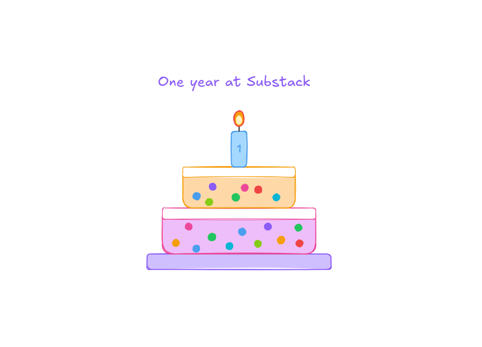

# 🎂One year of TPM Breakdowns, and the thing I want to build with you next.

**Special Edition** | *Why I write about this role, what a year of it taught me, and the community project on what it takes to lead when carrying all the accountability but none of the power*

*Michi Goetz - August 2026*

---

One year ago this week I published the first [TPM Breakdowns](https://michigoetz.substack.com/) post. I didn’t start it to build a newsletter. I started it because everywhere TPMs have been gathering - the meetups I help host in 🇪🇸 [Madrid](https://lnkd.in/p/d8RpEVA2), 🥨[Munich](https://lnkd.in/p/dtCfT4Mg), 💂🏼‍♂️[London](https://lnkd.in/p/dMN7tjdE), 🗽[New York](https://www.linkedin.com/posts/michi-goetz_tpm-basecamp-2025-thank-you-it-brought-activity-7396172282265776128-H6zK), the podcasts, the DMs - I kept running into the same thing: a real hunger to understand this role better, and almost nowhere good to send people. A room holds thirty. A podcast reaches a few thousand who mostly forget it. The demand was real and the supply was thin, so I started writing to meet it at scale.

And it is a role worth the effort. Technical program management is one of the most valuable jobs in tech and one of the least well written about, and I wanted to fix the second half of that sentence.

A year later that’s still the point, more than any subscriber number. So instead of a lap around my own metrics, here’s what this has actually been for, what a year of it taught me, and where we go next.

### **What this is for**

Every large program runs on a job most people can’t quite see: someone holding the whole system at once, across teams they don’t manage, and turning it into something that ships. That is the work I write for. Not the status decks. The judgment underneath them.

Everything I’ve published sits on two rails, and both serve that same job:

- **[Practical AI](https://michigoetz.substack.com/t/practical-ai)** is the tooling. How to hand the machine the admin - the summaries, the status, the first drafts - so you get back to the work that actually needs a human. The **[TPM AI Playbook on GitHub](https://github.com/michigoetz/tpm-use-cases)** will soon be fully enriched with an agentic architecture. Stay tuned!
- **[The Seat](https://michigoetz.substack.com/t/the-seat)** is the craft. The judgment, the influence without authority, the permission to do the parts of the job nobody hands you.
- **[TPM Memes](https://michigoetz.substack.com/t/memes)** is the fun. Building software is about people and we end up in funny situations and should enjoy the process. Yes, I know - we need to continue weekly.

Different subjects, one purpose: give Technical Program Managers the tools and the language to do the real work, and to be seen doing it. And alongside a group of practitioners I helped build **[AI for TPMs](https://aifortpms.substack.com/)** and run the [State of AI for TPMs survey](https://aifortpms.substack.com/p/state-of-ai-for-tpms-2026), 252 of us, because a profession this central should have its own data instead of being a footnote in everyone else’s.

### **What a year of writing taught me**

The clearest thing a year of this taught me is where the real work actually lives, and how little of it anyone writes for.

The more I wrote, the more obvious it got that the hard part of the job was never the coordination. It’s the judgment. Which risk is real and which is noise. Whose “yes” actually unblocks a program. Which technically correct answer is also survivable in a tense room. That layer is where programs quietly succeed or fail, and it’s the layer almost no playbook covers, because it doesn’t fit in a status report and you can’t demo the disaster that quietly didn’t happen.

That’s also why the “AI will replace TPMs” panic got it backwards this year. AI took the administrative half, the half I was glad to lose. What’s left underneath is exactly the judgment, and it got heavier, not lighter. The role isn’t shrinking. It’s being distilled to the part that was always the point.

Next to this,  is all about community and I connected with so many of you in a meaningful way and it is contrasts with the chaos inherent to most other platforms. It reminds me of how blogging was fun in the early 2010’s.

🙏 Thank you for all the comments, feedback, likes and how to improve the writing and content!

### **The honest part**

One number, because I’d rather you trust the rest. A year in, 272 people have let me into their inbox, and what still gets me is that 150+ of you read every piece. But growth was never why I started, and it isn’t why I’ll keep going. The reason is everything above and everything next.

### **What we build next**

Next to some exciting announcement coming up for Practical AI, one recent topic came up in many discussions and I want to build it with the community together.

Beginning of October I want to work with many in the tech industry and beyond on

All the Accountability, None of the Power - A Community Project!

An honest account of the hardest, most human part of this work: owning the outcome across teams you don’t control, and making the call nobody else will. That part doesn’t hand off to an agent, because someone still has to own it. Written not by me alone, but by the people who live it.

If you do this work, I want you in it.

In addition, deeper on the systems thinking that is necessary for technical leadership. And more of the TPM AI Playbook, the open skills and workflows I’ve been putting on GitHub for you to clone and run against your own programs. That is the part I most want to keep building, with you, not just for you.

I’m not chasing a viral moment. The people who found this in month two are mostly still here in month twelve, and they’re here for the work. That’s the whole game.

### **Thank you**

None of it happens without a specific set of people on Substack!

None of it happens without a specific set of people.

The State of AI for TPMs survey was a real collaboration. Thank you to , **,** , , and  who built  alongside me and turned “someone should measure this” into 252 real answers.

Although we have decided to pause the [TPM Ridge Podcast](https://open.spotify.com/show/6n4fTGQ9WLK52H9xsU6DFW), I had the opportunity to be a guest on  hosted by  and contributed a guest article.

And the people who show up in the replies every week (Hi 👋, , ) with something real who keep me honest by challenging the articles and notes. You are the reason a Note becomes a conversation instead of a broadcast. I read every reply, and I mean that.

Two things would genuinely help me into year two:

1. **Recommend TPM Breakdowns** to the one person you can picture right now who runs programs and is tired of advice written for someone else.

2. **Reply and tell me** you want in on “***All the Accountability, None of the Power,***” and which piece this year mattered most. I read every one.

Here's to year two. Let's build it together.

Michi

---

*Originally published on [TPM Breakdowns](https://michigoetz.substack.com/p/one-year-of-tpm-breakdowns), Aug 27, 2026.*
